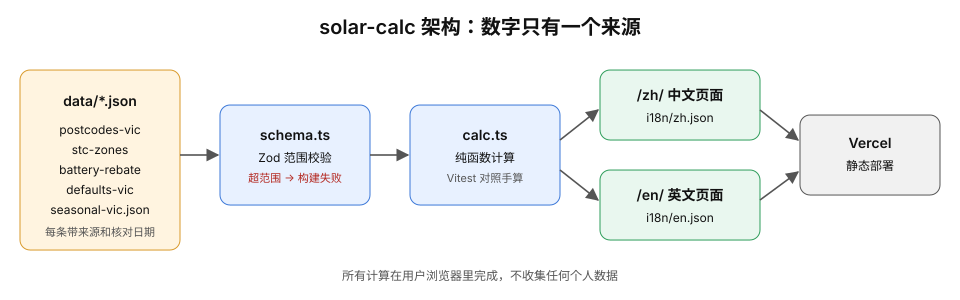

# solar-calc

维州太阳能与电池回本估算器，提供中文和英文页面，支持只装太阳能、太阳能加电池、已有太阳能只加电池。表单计算在浏览器内完成，展示能量流、回本年限、电池增量收益和电价变化情景。

[中文计算器](https://solar-calc-snowy.vercel.app/zh/) · [English calculator](https://solar-calc-snowy.vercel.app/en/) · [数据来源与免责声明](https://solar-calc-snowy.vercel.app/zh/sources/)

当前为 v0.1 的简化模型（版本范围来自项目规划）。结果是估算，不保证实际发电量、省钱或回本，不构成财务或投资建议。默认报价为二手来源，仅供参考，应以安装商针对现场提供的报价为准。

## 本地开发

技术栈为 Astro 静态页面、原生 TypeScript、Zod 数据校验和 Vitest；实际依赖与命令见 [package.json](package.json)，依赖版本由 [package-lock.json](package-lock.json) 锁定。

```bash
npm ci
npm run dev
```

使用开发服务器输出的地址访问中文或英文页面。提交前运行：

```bash
npm test
npm run build
```

`npm test` 先运行 TypeScript 检查，再运行 Vitest。`npm run build` 生成 `dist/` 静态页面；可用 `npm run preview` 检查构建产物。计算不需要服务器接口或用户账号。

## 如何使用

- 选择安装方案、维州邮编、安装日期和配电区；邮编必须属于数据表收录的区间。
- 填入家庭全年用电量，或用电费单反推。已有太阳能的家庭宜填写包含自发自用的家庭总用电，而非仅填写电网购电量。
- 按实际用电习惯选择白天占比，填写新装或已有太阳能容量、电池放电端可用容量。
- 买电和上网电价按自己的账单填写。参考报价只匹配数据中明确给出的容量；换到没有参考价的容量时，会清空未手改的自动报价并要求填写，手填报价会保留。
- 确认报价是否已扣 STC 补贴，分别填写太阳能和电池报价，避免重复扣补贴。

首次访问根据浏览器语言选择页面：`zh*` 使用中文，其他使用英文；手动切换后的语言偏好优先。金额统一显示为澳元（AUD）。

## 建模思路

模型使用“四季各一个平均日”。[src/lib/calc.ts](src/lib/calc.ts) 实现计算，[tests/fixtures/hand-calc.md](tests/fixtures/hand-calc.md) 给出独立手算口径与核对结果。下述公式中的换算、逐年变化及报表期限均来自该手算文件；参数值来自各段注明的数据文件。

### 发电与用电拆分

全年首年发电量按 `P × R × 1000` 计算：`P` 是太阳能容量（kW），`R` 是 CER 分区系数（MWh/kW/年），换算后为 kWh。邮编映射见 [data/postcodes-vic.json](data/postcodes-vic.json)，系数见 [data/stc-zones.json](data/stc-zones.json)。

BOM 月平均每日太阳辐照量乘当月天数，再归一化成季节发电权重；只使用相对权重，不用 BOM 的绝对辐照量重新推算全年发电。家庭年用电量按 AER 季节用电比例拆分。季节、月份、天数、日照和用电权重的原始数据均在 [data/seasonal-vic.json](data/seasonal-vic.json)。

每个季节的全年分配量除以该季天数，得到平均日值：

```text
G = 全年发电量 × 当季发电权重 ÷ 当季天数
L = 全年用电量 × 当季用电权重 ÷ 当季天数
L_day = L × 白天用电占比
L_night = L − L_day
D = min(G, L_day)
E = G − D
```

`D` 是太阳能直接自用，`E` 是直接自用后的剩余发电。各季日值乘以季节天数再求和，得到全年电量；年用电量、季节比例和白天占比在预测期间保持不变。

### 电池能量流与利用率

电池按“默认充满”的稳态处理，每天只补充前一晚使用的电量；不逐时追踪荷电状态。充电来自剩余太阳能，不模拟电网充电或套利。`C_n` 为当年的放电端可用容量，`η` 为充放电效率：

```text
B_out = min(E × η, C_n, L_night)
B = B_out ÷ η
X = E − B
电池损耗 = B − B_out
```

`B_out` 是电池放电，`B` 是太阳能送入电池的电量，`X` 是上网电量。无电池时剩余发电直接上网。首年利用率为“全年放电量 ÷ 全年天数 ÷ 初始可用容量”；低利用率只提示电池可能偏大，不代表推荐容量或经济最优解。

### 省钱、净成本与回本

以下公式使用全年电量，`p` 为买电价、`f` 为上网电价，均换算为 AUD/kWh：

```text
新装太阳能（含无电池或加电池）：全年省钱 = (D + B_out) × p + X × f
已有太阳能只加电池：全年增量省钱 = B_out × p − B × f
```

只加电池的基线是“同样的已有太阳能、没有电池”，因此扣除充电带来的上网收入损失，不把已有太阳能的省钱重新算作电池收益。每日口径需按季节天数汇总，全年口径不再重复乘全年天数。供电费不因安装方案而改变，所以不计为省钱。

- 报价默认已扣补贴、含 GST 和安装费，净成本直接使用报价；选择未扣补贴时，分别减去对应设备的 STC 张数乘用户输入的 STC 单价。补贴超过对应报价会报错，不生成负成本。
- 回本为累计省钱首次达到净成本的年份。整体按 **30 年**预测，页面显示整体 **10 年净收益**，电池展开项显示 **10 年增量省钱**；净收益为累计省钱减净成本，未计维护及资金成本。期限来源：[hand-calc.md](tests/fixtures/hand-calc.md) 的结果表和整体未回本压力用例。
- 电池另外显示增量回本、计收益期累计放电、每度放电成本及同期平均增量节省：分别用电池净成本、同期累计增量省钱除以同期放电量。电池从不放电时，这些指标显示不可用，不显示“零年回本”。
- 电价情景只改变买电价，上网电价保持不变；同时提供上网电价为零的对比。

### 逐年衰减与计收益期

参数 `d` 为面板年衰减率，`g` 为买电价年涨幅，`r` 为质保末期保留容量，`W` 为质保年限，`n` 为预测年份：

```text
第 n 年发电 = 首年发电 × (1 − d)^(n − 1)
第 n 年买电价 = 首年买电价 × (1 + g)^(n − 1)
第 n 年电池容量 = max(0, C × [1 − (1 − r) × (n − 1) ÷ W])
```

电池分别按质保期和预期寿命上端情景计收益，并受累计放电吞吐上限约束，先到者停止计电池收益。若年中触及吞吐上限，以剩余额度占当年预计放电的比例，把当年拆成有电池和无电池两部分；停止计电池收益后，太阳能仍继续计算，电池不自动更换。计收益结束不代表电池物理报废。

**已有太阳能只加电池时，面板衰减也从预测第 1 年重新算起。** 当前不输入已有面板的年龄或历史衰减，因此可能高估老旧系统的发电及可用于充电的余量。这与手算采用的首年基准一致，不是对已有设备状态的测量。

## 默认值与全部模型假设

以下为当前数据快照，不是对未来价格或设备表现的保证。用户可填写实际容量、报价、用电和电价；模型内部的效率、衰减及情景参数取自数据文件。

| 项目 | 当前取值或假设 | 来源文件及字段 |
| --- | --- | --- |
| 新装 / 已有太阳能默认容量 | 均为 6.6 kW | [defaults-vic.json](data/defaults-vic.json)，`assumptions_from_plan` |
| 电池默认可用容量 | 10 kWh，按放电端计，不等于标称容量 | [defaults-vic.json](data/defaults-vic.json)，`battery_usable_kwh`；[hand-calc.md](tests/fixtures/hand-calc.md) |
| 白天用电占比 | 上班不在家 0.30、部分在家 0.45、基本在家 0.60，各季使用同一占比 | [defaults-vic.json](data/defaults-vic.json)，`daytime_share` |
| 充放电效率 | 0.90，固定不变，不另模拟功率限制或逐时调度 | [defaults-vic.json](data/defaults-vic.json)，`round_trip_efficiency`；[hand-calc.md](tests/fixtures/hand-calc.md) |
| 面板年衰减 | 0.005 | [defaults-vic.json](data/defaults-vic.json)，`panel_degradation_per_year` |
| 买电价年涨幅 | 0%、3%、5%；上网电价不涨 | [defaults-vic.json](data/defaults-vic.json)，`price_escalation_scenarios`；[hand-calc.md](tests/fixtures/hand-calc.md) |
| 电池质保情景 | 10 年，末期保留容量参数 60%，每 kWh 初始可用容量累计放电上限为 3.0 MWh | [defaults-vic.json](data/defaults-vic.json)，`battery_warranty` |
| 电池预期寿命情景 | 15 年，是政府指南 10–15 年区间上端；质保期后沿用相同线性衰减速度及吞吐上限 | [defaults-vic.json](data/defaults-vic.json)，`battery_expected_life` 及其 `source_note` |
| 低利用率提示 | 首年平均每日放电 / 可用容量低于 0.60 时提示 | [defaults-vic.json](data/defaults-vic.json)，`battery_utilisation_warning` |
| 默认配电区与买电价 | Jemena，27.47 c/kWh；供电费 AUD 1.2713/天；其他配电区从表中选择 | [defaults-vic.json](data/defaults-vic.json)，`default_distributor`、`vdo_flat_2026_27` |
| 默认年用电 | 5,077 kWh；AER 维州气候区 6 三口之家基准 | [defaults-vic.json](data/defaults-vic.json)，`annual_usage_kwh`、`source_note` |
| 季节用电比例 | 按夏 1,143、秋 1,165、冬 1,606、春 1,163 kWh 归一化 | [seasonal-vic.json](data/seasonal-vic.json)，`load_kwh_by_season` |
| 日历 | 平年 365 天；夏 90、秋 92、冬 92、春 91 天 | [seasonal-vic.json](data/seasonal-vic.json)，`days_in_month`、`seasons`；[hand-calc.md](tests/fixtures/hand-calc.md) |
| 默认上网电价 | 0 c/kWh；应按实际账单修改 | [defaults-vic.json](data/defaults-vic.json)，`feed_in_tariff_c_per_kwh` |
| 默认 STC 单价 | AUD 38，是用户确认的方案假设，不是官方市场报价 | [defaults-vic.json](data/defaults-vic.json)，`stc_price_dollars`、`source_note` |
| 太阳能参考报价 | 6.6 kW：AUD 6,200 | [defaults-vic.json](data/defaults-vic.json)，`typical_quotes_after_rebate` |
| 电池参考报价 | 10 kWh：AUD 9,240；20 kWh：AUD 16,490 | [defaults-vic.json](data/defaults-vic.json)，`typical_quotes_after_rebate` |

电池质保参数是根据不同品牌官方文件选取的保守组合，不代表某一款产品的完整质保条件。预期寿命情景继续沿用质保吞吐上限属于额外假设，不是官方的物理寿命限额。上述参考报价来自第三方汇总或预测，均已扣补贴、含 GST 和安装，不能作为其他容量的推算单价；这些口径见 [defaults-vic.json](data/defaults-vic.json) 各嵌套记录的 `source_note`。

用电费单反推时先扣除“账期天数 × 该配电区每天供电费”，再除以买电价并年化。假设账单为平价用电，不含光伏抵扣、折扣或其他费用；相关公式和核对用例见 [hand-calc.md](tests/fixtures/hand-calc.md) 的“电费单反推全年用电”。

### STC 补贴口径

- 面板张数为 `floor(容量 × 分区系数 × 安装年份视同年限)`，只对新装面板计补贴；已有面板在只加电池模式下不重复领取。政策系数和年份表以 [stc-zones.json](data/stc-zones.json) 为准。
- 电池按安装日期选择系数，最多计前 **50 kWh** 可用容量；**2025-07-01** 起纳入资格期。**2026-05-01** 起，**0–14 kWh、14–28 kWh、28–50 kWh** 分别按 **100%、60%、15%** 计入容量，再乘系数并向下取整；之前按未分档容量计算，仍受容量上限约束。数字与日期均来自 [battery-rebate.json](data/battery-rebate.json)。
- 电池张数向下取整是保守的模型选择，不把它描述成 CER 已明示的电池取整规则；依据见 [battery-rebate.json](data/battery-rebate.json) 的 `source_note`。
- 安装日期超出收录的政策表时，显示该补贴不适用，不外推政策；完整日期边界和未来半年节点核对表见 [hand-calc.md](tests/fixtures/hand-calc.md)。
- 电池补贴要求标称容量 **5–100 kWh**，依据见 [battery-rebate.json](data/battery-rebate.json) 的 `source_note`。当前仅显示资格提示，尚未输入标称容量或执行真正的范围检查；不能用可用容量替代标称容量，也不能把估算结果当作资格确认。

## 数据来源与复核标记

| 数据文件 | 内容与来源 |
| --- | --- |
| [postcodes-vic.json](data/postcodes-vic.json) | CER 邮编与日照分区映射 |
| [stc-zones.json](data/stc-zones.json) | CER 分区系数与面板 STC 视同年限 |
| [battery-rebate.json](data/battery-rebate.json) | CER 电池补贴日期、系数、分档和容量口径 |
| [defaults-vic.json](data/defaults-vic.json) | ESC 电价、AER 用电基准、STC 单价假设，以及各自带元数据的参考报价、官方质保文件与寿命参考 |
| [seasonal-vic.json](data/seasonal-vic.json) | BOM 月日照、AER 季节用电和季节定义 |

每个根记录及带元数据的嵌套记录独立维护 `source`、`source_note`（有补充说明时）、`last_checked` 和 `checked_by`：

- `source` 为 HTTPS 链接或链接数组；政策与统计数据、第三方参考价、用户确认的模型假设应按 `source_note` 区分，不能混为官方结论。
- `last_checked` 是核对日期，不是发布日期，也不保证来源此后未变化。
- `checked_by: "ai"` 在来源页显示“待复核 / Pending review”；`"human"` 显示“人工核对 / Human reviewed”，只反映文件中记录的复核状态。
- 子记录使用自己的日期与标记，不继承父记录。修改或更新数据后应重新核对，并相应维护元数据。

[src/lib/data.ts](src/lib/data.ts) 统一加载文件，经 [src/lib/schema.ts](src/lib/schema.ts) 检查范围、日期、HTTPS 来源以及跨文件的邮编分区日照覆盖；校验失败时页面构建失败。来源页从这些元数据生成，不另维护一份来源清单。

## 独立手算与验证

[tests/fixtures/hand-calc.md](tests/fixtures/hand-calc.md) 是计算测试期望值的依据，由独立的 [hand_calc.py](tests/fixtures/hand_calc.py) 生成，不调用 `calc.ts`。原有 **3 个用例**及误差 **小于 1%** 的要求见该手算文件；另包含补贴边界、报价未扣补贴、账单反推及政策切换核对。

手算中的上网电价 **5 c/kWh** 是测试输入，不能当成网站默认值；网站默认仍为 **0 c/kWh**。数字出处为 [hand-calc.md](tests/fixtures/hand-calc.md)“公共输入”和 [defaults-vic.json](data/defaults-vic.json)。新增财务期望值应先做独立手算，不能从计算引擎输出反推。开发时修改手算脚本后可用 `python3 tests/fixtures/hand_calc.py` 重新生成并审阅结果。

## 已知局限

- **容量范围**：新装和已有太阳能均限于 100 kW（含）以内，v0.1 不实现中型系统规则，上限与 CER 来源见 [defaults-vic.json](data/defaults-vic.json) 的 `home_system_scope`。
- **四季平均日**：不能还原逐小时的发电与用电重合、天气波动、充放电调度和功率约束；模型适合估算和对比，不是设备设计或逐时仿真。
- **水平面辐照**：BOM 数据未按屋顶朝向、倾角、遮挡和温度修正，不能笼统声称结果一定偏保守。依据：[seasonal-vic.json](data/seasonal-vic.json) 的 `source_note`。
- **两个站点代表分区**：分区 4 使用 Melbourne Olympic Park，分区 3 使用 Bendigo Airport；同分区邮编不意味着相同微气候或屋顶条件。站点与分区来源：[seasonal-vic.json](data/seasonal-vic.json)。
- **AER 默认负荷曲线**：基准来自 2019 年电网购电样本，把季节比例套用到家庭总用电是假设，不一定适用于已有光伏或全电气化家庭。样本年份和口径来源：[seasonal-vic.json](data/seasonal-vic.json) 的 `source_note`。
- **没有分时电价**：只使用平价买电与固定上网电价，不模拟峰谷时段、电网充电套利；账单反推也依赖这一简化。
- **已有面板年龄未建模**：只加电池时仍从首年基准重新计算面板衰减，不能反映已使用多年的面板现状。
- **电池与财务简化**：衰减是固定线性速度，预期寿命和吞吐上限是情景假设；不计维护、资金成本或电池更换，也不保证补贴资格。实际设备、政策、电价和用电变化均会影响结果。
- **验证覆盖仍有待补充**：小电池、高夜间负荷、年中达到吞吐上限的独立手算用例已推迟到 v0.2；计划见 [docs/todo.md](docs/todo.md)。

## 架构



数据先校验，再进入纯函数计算引擎；页面脚本读取表单并调用引擎，结果文案由中英字典提供。能量流 SVG 展示已有计算结果，不新增一套计算口径。来源页复用数据元信息。静态页面部署到 Vercel，输入计算留在浏览器。

## 隐私

以下文字与网站当前的中英文隐私说明一致，来源为 [src/i18n/zh.json](src/i18n/zh.json) 和 [src/i18n/en.json](src/i18n/en.json)：

> 在浏览器内计算，不上传你的输入。切换语言时，会在本标签页临时保存已填输入，新页面读出后立即删除。仅长期保存语言偏好。

> Calculated in your browser; your inputs are not uploaded. When you switch languages, completed inputs are temporarily saved in this tab and deleted as soon as the new page reads them. Only your language preference is saved long term.

表单输入通过同一标签页的 `sessionStorage` 暂存以完成语言切换，目标页面读取后立即删除；语言偏好使用 `localStorage`。项目不收集计算输入，不加第三方追踪、广告或联盟链接。

## v0.2 计划

以下是项目规划中“v0.2 方向”的摘要，尚未实现；其中的数值是规划参数，不属于当前计算模型。

- 改为全年 **8760 小时**模拟，使用 NASA POWER 多年平均日照，按倾斜面修正；光伏出力纳入 **88%** 降额、辐照和温度修正。这些时序与降额参数来自项目规划的 v0.2 方向。
- 电池采用 Load Following 调度，计划最低 SOC **20%**，并加入智能充电与充电上限。SOC 规划值来自项目规划。
- 支持家庭电表 **30 分钟 CSV**，仅在浏览器内处理；或使用可引用的典型负荷曲线。时间分辨率来自项目规划。
- 支持分时电价（ToU），专业模式提供 NPC/COE 和可调折现率。
- 为电池标称容量增加真正的补贴资格检查，并补充年中触达吞吐上限的独立手算覆盖；另见 [docs/todo.md](docs/todo.md) 及计算引擎现有待办注释。
